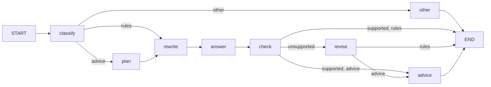

# Heroes of Might and Magic: Olden Era assistant

A question-answering assistant for the game data of *Heroes of Might and Magic: Olden Era*:
units, abilities, spells and artifacts. It answers questions like *"Which units can't be
counterattacked?"* or *"Can any creature steal buffs from enemies?"* from the official
game data, not from a model's memory.

It can be used in two ways:

- **In Claude Desktop, through MCP.** A local MCP server offers the game-data tools to Claude.
- **As a local pipeline** (LangGraph + Ollama) that runs entirely on your own computer.

This is a learning project: it covers data processing, SQL, embeddings, retrieval with
reranking, tool-calling agents, LangGraph workflows and MCP.

---

## How it works

### Data

```
Wiki (Cargo API) ──download──> data/raw/v<patch>/        raw JSON per table, plus a manifest
                 ──process───> data/processed/v<patch>/  cleaned, joined with the English text
                 ──build─────> data/hoe.sqlite            structured data: stats, costs, levels
                             > data/chroma/               one embedding per ability, spell, artifact
```

The data comes from the official wiki's Cargo tables
([wiki.hoodedhorse.com](https://wiki.hoodedhorse.com/Heroes_of_Might_and_Magic_Olden_Era)).
Each game patch gets its own folder, so a new patch can be added next to the old one.

### Tools

| Tool | What it does | Backed by |
|---|---|---|
| `query_units` | Filter and sort units by faction, tier and stats | SQLite |
| `search_rules` | Find abilities, spells and artifacts whose effect matches a question | Chroma + reranker, details from SQLite |

`search_rules` retrieves in two stages: an embedding search (Qwen3-Embedding-0.6B) narrows
the ~790 documents to 30 candidates, then a cross-encoder (Qwen3-Reranker-0.6B) reads each
candidate together with the question and reorders them. On the test questions, reranking
moved the right answer from rank 14 to rank 1 for the hardest case.

### The local pipeline (LangGraph)



| Node | Job |
|---|---|
| `classify` | Sorts the question: facts (`rules`), opinion or strategy (`advice`), or off-topic (`other`) |
| `plan` | For advice questions: lists the facts needed |
| `rewrite` | Translates player slang into the game's terms ("buff" → "positive effect") |
| `answer` | A tool-calling agent that collects the facts |
| `check` | Splits the answer into single claims and checks each one against the tool results |
| `revise` | Removes or corrects unsupported claims |
| `advice` | Writes an opinion based only on the verified facts, labeled as an opinion |

---

## Requirements

- Windows (tested), Python 3.14
- NVIDIA GPU recommended (tested with 8 GB). Without one, reranking takes about 30 s per search instead of about 1 s.
- [Ollama](https://ollama.com) with `qwen3:8b`, for the local pipeline
- [Claude Desktop](https://claude.ai/download), for the MCP server

---

## Setup

**1. Create a virtual environment**

```powershell
python -m venv .venv
.venv\Scripts\activate
```

**2. Install PyTorch with CUDA (before the other packages)**

The default `pip install torch` on Windows installs a CPU-only build. Get the exact command
for your CUDA version from [pytorch.org](https://pytorch.org/get-started/locally/)
(Stable, Windows, Pip). It looks like this:

```powershell
pip install torch --index-url https://download.pytorch.org/whl/cu1xx
```

Check it:

```powershell
python -c "import torch; print(torch.__version__, torch.cuda.is_available())"
```

**3. Install the rest**

```powershell
pip install -r requirements.txt
```

To reproduce the exact tested environment, use `requirements-lock.txt` instead.

**4. Pull the local model** (only for the local pipeline)

```powershell
ollama pull qwen3:8b
```

---

## Build the data

Run these in order. Each step reads the previous step's output.

```powershell
python download_raw_data.py     # wiki -> data/raw/v<patch>/   (skips a patch that is already downloaded)
python raw_data_processing.py   # -> data/processed/v<patch>/  (prints a summary and checks invariants)
python create_sql_db.py         # -> data/hoe.sqlite
python create_vector_db.py      # -> data/chroma/              (downloads the embedding model on first run)
```

When the game gets a new patch, run all four again. The download creates a new
`v<patch>` folder, and the later steps use the newest one.

---

## Use it

### In Claude Desktop (MCP)

In Claude Desktop: **Settings → Developer → Edit Config**, then add the server to
`claude_desktop_config.json` (use your own paths):

```json
{
  "mcpServers": {
    "heroes-olden-era": {
      "command": "C:\\path\\to\\project\\.venv\\Scripts\\python.exe",
      "args": ["C:\\path\\to\\project\\mcp_server.py"],
      "env": { "HF_HUB_OFFLINE": "1" }
    }
  }
}
```

Restart Claude Desktop fully (also from the system tray). The server offers three tools:

| Tool | Speed | Notes |
|---|---|---|
| `query_units` | milliseconds | Unit stats from SQLite |
| `search_rules` | about 1 s | Rules search with reranking |
| `ask_hoe` | 30 to 90 s | Runs the whole local pipeline. Ollama must be running |

`HF_HUB_OFFLINE=1` skips the online checks for the Hugging Face models. Set it only after
`create_vector_db.py` and one search have downloaded both models.

To test the server without Claude Desktop: `mcp dev mcp_server.py` opens the MCP Inspector
in the browser (needs Node.js).

### Locally (LangGraph + Ollama)

```powershell
python run_graph.py                                    # the built-in test questions
python run_graph.py "Which units can raise dead units?"
```

It prints the path through the graph, the time per node, the tool calls, the checked claims
and the final answer.

---

## Tests and evaluation

```powershell
pytest                     # tool tests: known unit values, filters, invalid inputs
python eval_rerank.py      # retrieval: hit@3 with and without reranking, time per query
python check_grounding.py  # the claim checker on cases with known verdicts
```

---

## Project structure

| File | Purpose |
|---|---|
| `download_raw_data.py` | Downloads the Cargo tables for the current patch |
| `raw_data_processing.py` | Type conversion, text cleanup, joins, invariant checks |
| `create_sql_db.py` | Builds the SQLite database |
| `create_vector_db.py` | Builds the documents and embeddings, fills Chroma |
| `tools.py` | `query_units`, `search_rules` and model loading |
| `agent.py` | The tool-calling agent (`create_agent` + ChatOllama) |
| `graph.py` | The LangGraph pipeline |
| `mcp_server.py` | The MCP server for Claude Desktop |
| `run_graph.py` | Runs questions through the graph, node by node |
| `tests/test_tools.py` | Tests for the tools |
| `eval_rerank.py`, `test_models.py` | Retrieval evaluation and embedding model comparison |
| `check_grounding.py` | Tests for the claim checker |

---

## Known limitations

- **Data coverage:** units, abilities, spells and artifacts only. No heroes, hero skills or buildings.
- **Attack type and movement filters** are not implemented in `query_units` yet, so questions
  like "Which Temple units fly?" are answered incompletely.
- **The local 8B model** sometimes ignores the rewritten search terms. On the advice path it
  can describe the tools instead of calling them, so the advice then has no facts behind it.
- **The claim checker** can flag correct claims: rankings derived from a sorted list,
  statements limited to "the search results", and quotes that span JSON line breaks.
  It cannot verify which unit a number belongs to.
- **The opinions** are reasoning over the retrieved stats, not game experience. The model
  knows little about Olden Era strategy.

---

## Troubleshooting

| Symptom | Cause and fix |
|---|---|
| Claude Desktop shows the server as failed | Something wrote to stdout. In an MCP server, stdout is the protocol channel: use `print(..., file=sys.stderr)` |
| Database or Chroma not found when started from Claude Desktop | Relative paths. Build paths from `Path(__file__).resolve().parent` |
| Reranking takes 30+ s | PyTorch is the CPU-only build (`torch.cuda.is_available()` is `False`), or the model was loaded in bfloat16 on the CPU |
| Every pipeline step takes several seconds | Ollama reloads the model when `num_ctx` differs between calls. Use the same value everywhere |
| Generation suddenly slow | Not enough GPU memory: `ollama ps` shows part of the model on the CPU. Close other GPU users |
